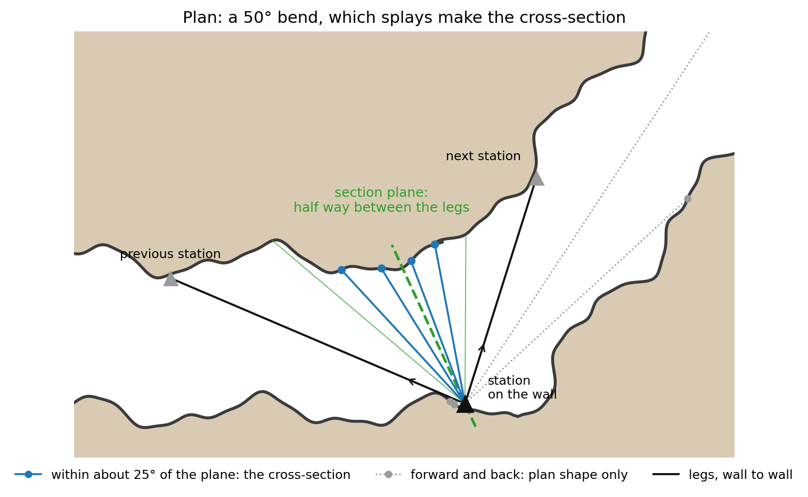
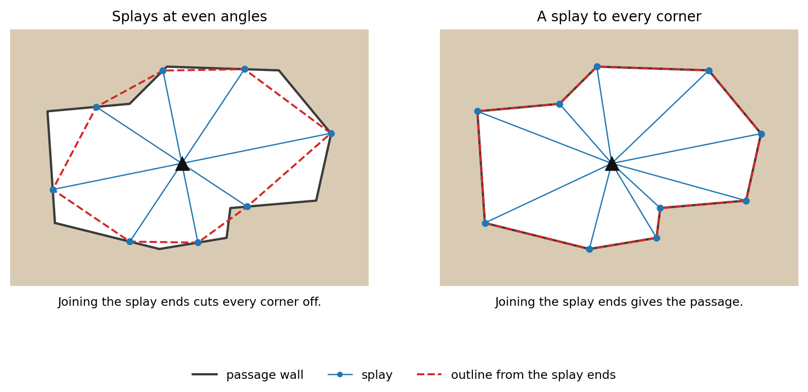
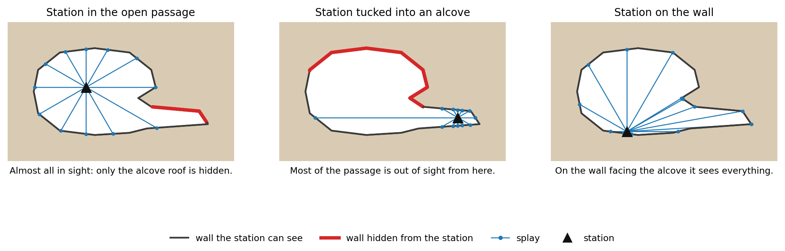
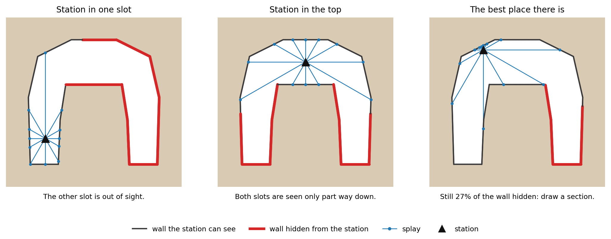
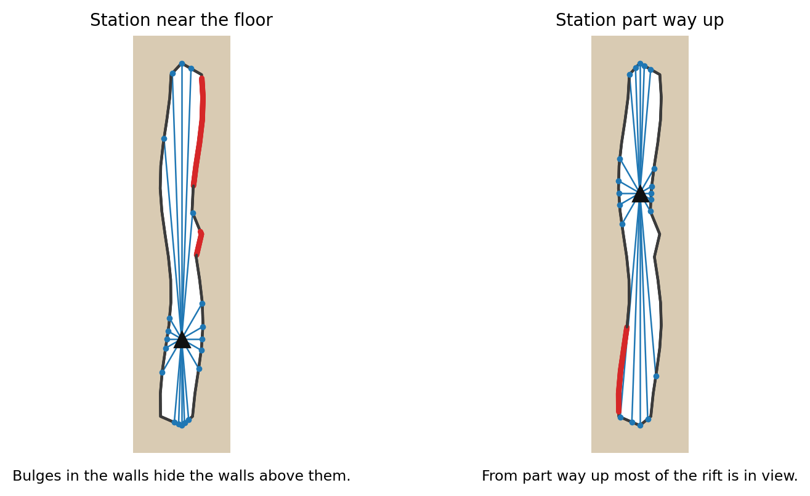
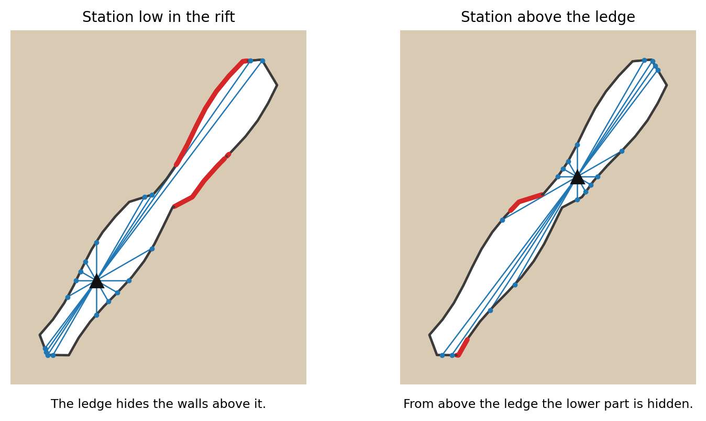
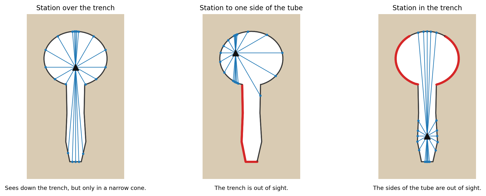
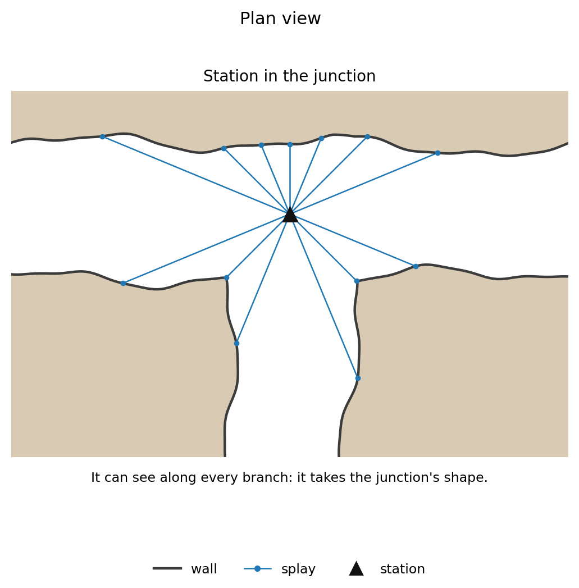
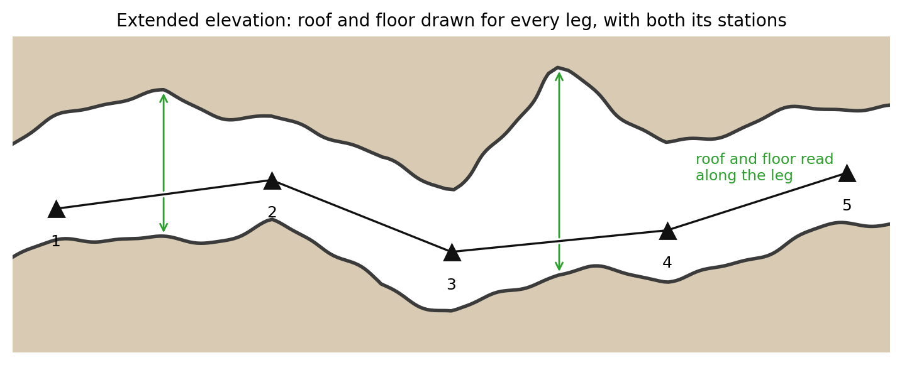

# Sketching in SexyTopo

*Andrew Atkinson, October 2026.*

The aim is to take most of the donkey work away from the process of taking SexyTopo sketches into Therion, and to survey efficiently. Less time underground and a better 3D model. The way you survey and sketch decides how good the drawings and the model are. These are conventions and export settings to help improve the process.

With modern survey kit, collecting the data is quick and easy. The drawing is now the slowest part. A team working to an agreed methodology gathers data more efficiently. Long legs are rarely the right answer. Legs that capture the detail, and allow splays to reach the important features, make the sketcher's job easier, better, and quicker.

## Basic rules

- Draw a cross section at as many stations as you can, and always where the splays cannot measure all the walls.
- Always put a station at a junction.
- Shoot splays to every corner at a junction.
- Shoot legs down every passage, even one you do not or cannot visit.
- At each junction, sketch a way down every passage, with its walls, floor and roof. Any distance will do.
- Never finish a survey at a junction: if the last station is one, draw a little way down each passage. Otherwise draw the passage on a little past the last station.

## The drawings and the model

Understanding the 3D model also helps. In most cases it needs the same as the sketch, but it is worth knowing how it is built. Therion's 3D model builds each passage from five things you produce in the cave:

- the centreline (the legs between stations);
- the splays at each station, which give the passage's cross section there;
- the plan drawing, which gives the walls;
- the extended elevation drawing, which gives the roof and floor;
- any cross sections you draw.

**The drawing always wins.** Where the drawing and the splays disagree, the model follows the drawing. Cross sections are sized to the plan and elevation.

The model uses only what is in the Therion files (.th and .th2), which is what you sketch in SexyTopo and export. Nothing is added from elsewhere, so what is not measured or drawn in the cave is missing from the model.

The drawings are checked against the survey: every leg and splay should lie inside the sketched walls.

## Stations

Put each station where it can see the passage's whole cross section; where no place can, draw a cross section.

### Which splays make the cross section

The model works out a section plane at each station: half way between the leg coming in and the leg going out, and upright unless the passage is steep. Cross section splays are detected by a plane of splays, ignoring the ones used for passage detail.

The plane lies half way between the legs, it is the bisector of the legs.

## Cross sections

Draw a cross section at as many stations as you can. The more you draw, the better the model, plus more detail for the sports caver and very useful data for science. Always draw one where the splays cannot measure all the walls.

Splay sections at every station, the first and last too, even where one was taken on a previous survey.

Elevations can have cross sections too: the usual kind (vertical), and ones drawn in plan view (horizontal).

*Splays at even angles cut the corners off. A splay to every corner gives better passage shape and makes the sketcher's job easier. It becomes a matter of joining the dots.*

**At a junction** with an obvious through passage and a minor side passage, draw the section of the through passage as if the side passage were not there.

Stations should be picked to allow splays to be taken at all parts of the passage. Anything red can only come from a drawn cross section.

Some passages have no suitable place that sees it all. Use a point where the station sees most, and draw a cross section.

### Common passage shapes

**Tall rift.** Bulges in the walls hide the walls above them. If you can, put the station part way up the rift. Shoot several splays up and down the rift as well as across it, to the highest roof point you can see; if the roof is out of sight, note its estimated height on the section.

*Tall rift: station near the floor and part way up.*

**Hading rift.** Shoot splays up and down its length as well as across it. A ledge or kink hides everything beyond it. In the plan, draw the walls at the outermost extent seen from above: the top edge on one side, the bottom edge on the other.

*Hading rift with a ledge: station below it and above it.*

**Keyhole**

*Keyhole: the station over the trench sees most.*

### Where the passage changes

The model blends from one station's cross section to the next. A narrowing, a step in the roof or a change from tube to rift part way along a leg becomes a smooth change unless there is a plan and elevation where these are used to inform the walls.

### At junctions

Put the junction station where it can see into every corner. Gathering lots of detail so that slightly goes into the passage helps.

*Plan of a junction: a station in the junction sees into every branch.*

### Pitches and steep passages

Put stations at the pitch head and foot with full rings of splays. The elevation is really the only way to capture detail.

## Sketching

Team work is important to make the sketching efficient. One method that works well for many people is.

Leg is shot, the sketcher confirms it is okay.

Cross section splays taken, wait for the sketcher. Go through the detailed splays the sketcher needs.

Take the next leg while the sketcher continues sketching.

## Conventions

Colours are only hints: ticks, dashes and loops decide what a line is.

| Colour | Draw with it |
| --- | --- |
| Black | Walls. A dashed black line is a wall you could not see (presumed). |
| Brown | Mud, sand, debris and boulders (rocks), on a wall or across the passage: closed loops are boulders (0.3 m or more across) or debris (smaller); dots or short dashes are sand or mud. |
| Grey | Steps, ledges, pitches, overhangs etc. inside the passage. |
| Blue | Water: a closed outline is a pool, maybe hatched A squiggle with an arrow showing direction is a water flow. |
| Green | Formations |
| Red, orange, purple | Passage overlaps another. Purple for walls, continue in normal colours outside the overlap. |

- **One stroke per wall.** Draw each wall as one continuous line where you can, and finish it on the wall it meets. A wall restarted beside itself is read as one wall (the outer stroke).
- **The wall's colour indicates what it is:** black is rock, brown sand or mud, green flowstone.
- **Boulder walls are drawn** with no line, the wall runs through their tops.
- Debris walls are rocks drawn with a line where the wall goes.
- **Mud:** a row of short straight brown dashes on the wall line.
- **Notes as text:** write notes, such as P for a pitch or C for a climb, with SexyTopo's text tool (new in SexyTopo), not as drawn strokes.
- **Both walls along every leg**, continuously.
- **Side passages and openings** even if they are not surveyed. A drawn passage deeper than the width of its opening, and at least 0.5 m deep, gets its own tube in the model; small bays and slivers are left out.
- **Where passages overlap** in plan, draw the passage over the other in purple (its walls) and red or orange (its other lines): see the colour table. It is drawn in a scrap of its own.
- **Steps and pitches by their ticks.** Generally grey but can be another colour, brown for mud or a boulder edge, green for a large calcite dam.
- Overhangs are dashes with ticks on the lower side.
- **Boulders as closed loops.** A few loops in a boulder floor are enough: the script fills the area.
- **Mud and sand** as brown dots or short dashes spread over the whole area. A single dot is taken as dirt on the screen.

## Plan

The plan walls set the passage's width in the model: the model stretches each cross section sideways to them.

## Extended elevation

Always sketch the elevation. It sets the roof and floor in the drawings and the model, with steps and climbs, and the projected elevation is made from it.

*The extended elevation: roof and floor drawn along every leg.*

- **One roof and one floor per passage**
- **Traverse:** drawn as a line with three or more short straight ticks hanging from one side.

## SexyTopo and its export

Use SexyTopo 1.12.3 or later. Set the Therion export so that a survey called SurveyName gives these files.

In the names below, `#` stands for a number: a scrap's number, or for a cross section its station.

| File | Holds | SexyTopo setting in Therion |
| --- | --- | --- |
| `SurveyName.th` | The data, date, team with roles, copyright, equates and maps | |
| `SurveyNameP.th2` | The plan sketch scraps `SurveyNameSP#` cross sections, `SurveyNameSX#` | Plan File suffix: P Plan Scrap suffix: SP# Plan x-section suffix: SX# |
| `SurveyNameEe.th2` | The extended elevation sketch scraps `SurveyNameSEe#` vertical cross sections `SurveyNameSVX#` horizontal cross sections `SurveyNameSHX#` | EE File Suffix: Ee EE scrap suffix: SEe# Vertical x-section suffix: SVX# Horizontal x-section suffix: SHX# |
| `Notes/` | A folder holding the xvi drawings | XVI folder: Notes |
| `SurveyNameP.xvi` | Plan sketch as a backdrop | Taken from file name |
| `SurveyNameEe.xvi` | Extended elevation sketch as a backdrop | Taken from file name |

Export folder name should be set to nothing (blank) and the export subtype tick box unticked

In the trip information, give the date and each person's role. The Licence should be GPLv3.0+

